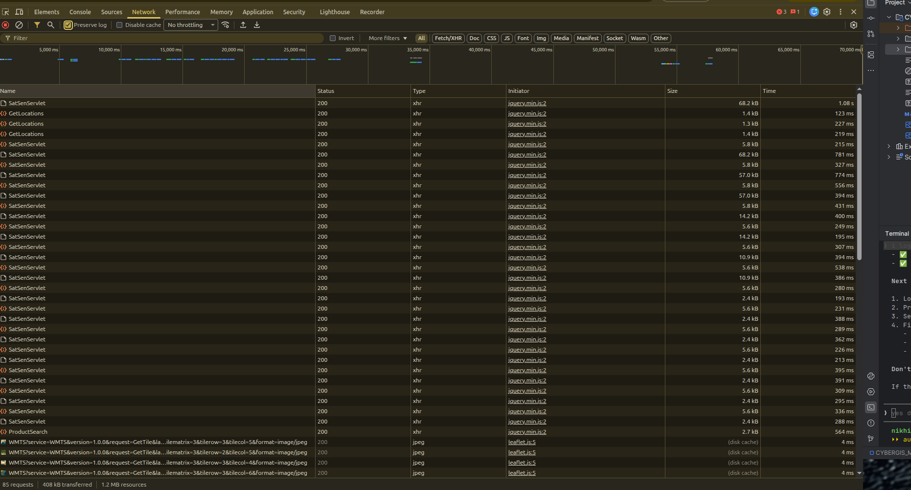
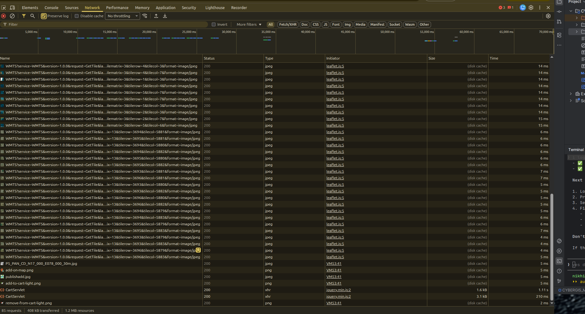
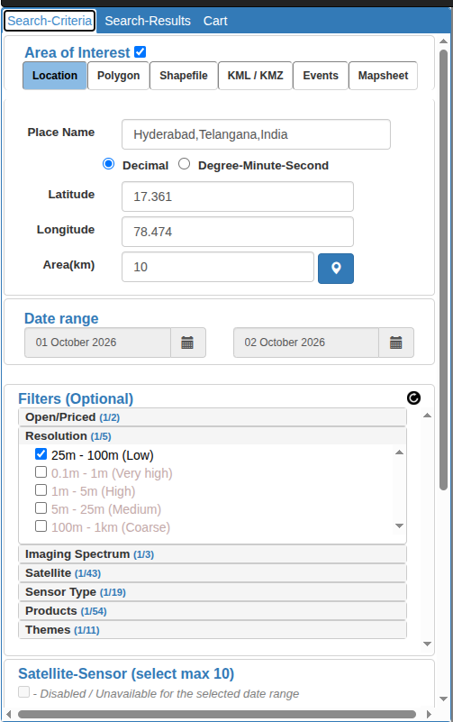
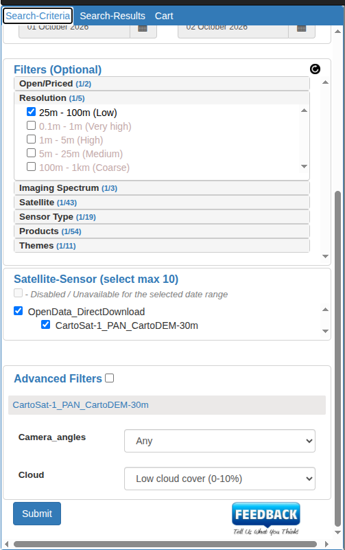

# CartoDEM OGC API - Coverages over Bhoonidhi

An **OGC API - Coverages** service for ISRO/NRSC's **CartoDEM 30 m** elevation model, built with
[pygeoapi](https://pygeoapi.io) on top of the [Bhoonidhi](https://bhoonidhi.nrsc.gov.in) data portal.

Bhoonidhi only lets you download CartoDEM as whole 1°×1° tiles, after logging in with an email OTP.
This service lets anyone request **just the area they need** with one HTTP GET:

```bash
# Elevation of a 0.1° × 0.1° patch of Hyderabad as a GeoTIFF: one request, no login, about 330 KB
curl -o hyderabad.tif \
  "http://localhost:5000/collections/cartodem/coverage?subset=Lat(17.35:17.45),Long(78.40:78.50)&f=GTiff"
```

The same data from Bhoonidhi directly means: log in with an OTP, search, download a 44.5 MB zip,
unzip a 52 MB GeoTIFF and clip it yourself in GDAL or QGIS.

---

## Contents

1. [The gap](#1-the-gap)
2. [What the service does](#2-what-the-service-does)
3. [Architecture](#3-architecture)
4. [The data](#4-the-data)
5. [API reference](#5-api-reference)
6. [OGC compliance](#6-ogc-compliance)
7. [The hybrid fetch layer](#7-the-hybrid-fetch-layer)
8. [Implementation choices](#8-implementation-choices)
9. [Setup and running](#9-setup-and-running)
10. [Project layout](#10-project-layout)
11. [Known limitations](#11-known-limitations)
12. [Bhoonidhi API findings](#12-bhoonidhi-api-findings)
13. [Future work](#13-future-work)
14. [Data credit](#14-data-credit)

---

## 1. The gap

**There is no standards-based way to request part of CartoDEM.** Every route Bhoonidhi offers delivers
whole tiles, and none of them is an OGC coverage interface. All checks below were made on 2026-10-11.

### 1.1 What Bhoonidhi offers today

| Access route | What it gives you | Subset an area? | OGC coverage standard? |
|---|---|---|---|
| Web portal ([bhoonidhi.nrsc.gov.in](https://bhoonidhi.nrsc.gov.in)) | Search, add to cart, download whole tile zips | No | No |
| Bhoonidhi API ([spec](https://bhoonidhi.nrsc.gov.in/bhoonidhi-api/)): `/data/search` | STAC catalogue search | No: `bbox` only **selects tiles** | No (STAC is for discovery) |
| Bhoonidhi API: `/download?id=&collection=` | Whole product by id | No | No |
| Portal map view | WMTS `GetTile` requests with `format=image/jpeg` | No | Map **pictures**, not elevation values |

### 1.2 Evidence

**The Bhoonidhi API has no coverage endpoints.** The API specification documents only `/auth/token`,
`/auth/logout`, `/data/collections`, `/data/search` and `/download`. WCS, WMS and OGC API aren't mentioned.
Probing for them confirms it:

| Request | Response |
|---|---|
| `GET https://bhoonidhi-api.nrsc.gov.in/wcs?service=WCS&request=GetCapabilities` | `404 Route Not Found` |
| `GET https://bhoonidhi-api.nrsc.gov.in/collections` | `404 Route Not Found` |
| `GET https://bhoonidhi-api.nrsc.gov.in/conformance` | `404 Route Not Found` |
| `GET https://bhoonidhi.nrsc.gov.in/geoserver/ows?service=WCS&request=GetCapabilities` | `404` |
| `GET https://bhoonidhi-api.nrsc.gov.in/data/collections/CartoSat-1_PAN_CartoDEM_30m` (no login) | `401 UNAUTHORIZED`: even the catalogue needs a login |

**The STAC catalogue has no data asset for CartoDEM.** The search result for tile `P5_PAN_CD_N17_000_E078_000_30m`
lists only a `metadata` (`.meta`) and a `thumbnail` (`.jpg`) asset. The elevation data is only reachable as a
whole-product download.

**Bhuvan, ISRO's other geoportal, has WCS switched off.**

| Request | Response |
|---|---|
| `GET https://bhuvan-vec1.nrsc.gov.in/bhuvan/wcs?service=WCS&request=GetCapabilities` | `ServiceUnavailable: "Service WCS is disabled"` |
| `GET https://bhuvan-ras1.nrsc.gov.in/bhuvan/wcs?...` | `403 Forbidden` |
| `GET https://bhuvan-ras2.nrsc.gov.in/bhuvan/wcs?...` | `404 Not Found` |

Bhuvan's WMS on `bhuvan-vec1` lists 6,672 layer entries. None is a national CartoDEM; there are only a few
regional elevation, contour and slope layers (`CG_ELEVATION`, `cleanganga:Elevation`, `sdv:Contour_ap_dem_1`),
and WMS returns rendered images, not values.

**The portal's own OGC use is visual only.** Its network traffic shows WMTS tile requests with
`format=image/jpeg` for the map background, then product search and cart servlets for the actual data:

| Portal search traffic | Add-to-cart traffic |
|---|---|
|  |  |

**Getting CartoDEM today is a manual, whole-tile process.** In the portal you pick an area, a resolution
filter and the `CartoSat-1_PAN_CartoDEM-30m` product, then download complete tiles:

| Area of interest | Product selection |
|---|---|
|  |  |

**The documented API cannot download CartoDEM at all.** With a valid token, used within seconds, exactly as
the specification describes, `/download` always answers
`401 {"Description":"UNAUTHORIZED","Action":"Invalid session detected! Please login."}`.
Search with the same token succeeds. Every variant was tested: fresh password-grant token, refresh-grant token,
token without `Bearer`, token as a query parameter, POST instead of GET, after logging out of the portal, and
with an OTP-verified portal token. The only working route is the web portal's own login, which **requires a
6-digit OTP emailed to the account holder**. The most complete community client,
[`bhoonidhi-downloader`](https://pypi.org/project/bhoonidhi-downloader/), uses the portal login with an
interactive OTP prompt for the same reason, not the documented API.

### 1.3 Why STAC isn't enough

Bhoonidhi's search follows STAC, which is an OGC Community Standard, so it's fair to ask whether Bhoonidhi
"already has an OGC interface". It does, but only for **finding files**. STAC tells you *which tile* covers
an area. It defines no way to ask the server for *the elevation values inside an area*: no spatial subsetting,
no field selection, no output-format choice. That is exactly what OGC API - Coverages (and WCS before it) adds.

### 1.4 Who this affects

Anyone who needs elevation for an area rather than a tile: a hydrologist modelling one watershed, an app
showing a terrain profile, a notebook sampling heights along a road. Today each has to log in with an OTP,
download whole tiles (often several, merged and clipped) and handle the data locally. None of it can be
automated end to end, because the OTP needs a person.

---

## 2. What the service does

- Serves CartoDEM for **all of India and its surroundings (68–98°E, 6–38°N)** as one OGC API - Coverages collection, `cartodem`.
- Returns **only the requested area**, by `subset` on `Lat`/`Long` or by `bbox`, as **GeoTIFF** or **CoverageJSON**.
- Returned pixels are **bit-identical** to the source data (checked by the test suite against a GDAL clip).
- **Fetches tiles on demand.** If a request touches a tile that isn't cached, the service finds it in Bhoonidhi's
  STAC catalogue, downloads it, converts it to a Cloud-Optimized GeoTIFF, adds it to the mosaic and then answers.
  Later requests for that area come straight from the cache.
- Needs **no login for users**. Only the service operator has a Bhoonidhi account.

| | Bhoonidhi today | This service |
|---|---|---|
| Get elevation for a 0.1° × 0.1° area | Log in with OTP → search → cart → download 44.5 MB zip → unzip 52 MB → clip yourself | **One GET**, about 330 KB GeoTIFF |
| Machine-to-machine access | Not possible (OTP needs a person) | Any HTTP client |
| Standard | STAC search only | **OGC API - Coverages** (8 conformance classes) |
| Response time, cached area | n/a | **about 15 ms** |
| Response time, first request for a new tile | n/a | **about 10–13 s** (fetched from Bhoonidhi once) |

---

## 3. Architecture

```
                     ┌──────────────────────────────────────────────────────────────┐
  HTTP client ──GET──▶  cartodem_service/app.py                                      │
  (curl, QGIS,       │   pygeoapi Flask app + middleware                             │
   Python, browser)  │   (malformed bbox → 400, Accept: image/tiff → f=GTiff)        │
                     │        │                                                      │
                     │        ▼                                                      │
                     │  pygeoapi OGC API - Coverages                                 │
                     │  (landing page, conformance, collections, schema, coverage)   │
                     │        │                                                      │
                     │        ▼                                                      │
                     │  cartodem_service/provider.py  CartoDEMProvider               │
                     │   1. request → pixel window on the India grid                 │
                     │   2. size limits (413 if too large)                           │
                     │   3. tiles.ensure_tiles(window) ──────────────┐               │
                     │   4. read window from data/cartodem.vrt       │               │
                     │   5. encode GeoTIFF or CoverageJSON           │               │
                     │                                               ▼               │
                     │  cartodem_service/tiles.py  (tile cache)                      │
                     │   which 1° tiles? cached? absent? → lock → fetch → COG → VRT  │
                     │                                               │               │
                     │  cartodem_service/bhoonidhi.py  (Bhoonidhi client)            │
                     │   STAC search: documented API, cached tokens, throttled       │
                     │   download:   portal session (OTP), whole tile zip            │
                     └───────────────────────────────────────────────│──────────────┘
                                                                     ▼
                                                     Bhoonidhi (NRSC/ISRO)
                                                     bhoonidhi-api.nrsc.gov.in  (search)
                                                     bhoonidhi.nrsc.gov.in      (download)
```

### Request flow

1. pygeoapi parses and validates the OGC parameters (`subset`, `bbox`, `properties`, `f`).
2. `CartoDEMProvider` converts the requested bounds into a **pixel window** on the fixed India grid,
   including every pixel that touches the area.
3. It rejects requests that are too large (see [limits](#74-limits)).
4. `tiles.ensure_tiles()` makes sure every 1° tile under the window is cached, fetching up to 4 from Bhoonidhi if needed.
5. The window is read from the VRT mosaic. Only the needed 512×512 blocks of each COG are read from disk.
6. The pixels are encoded as GeoTIFF (DEFLATE compressed) or CoverageJSON.

---

## 4. The data

### 4.1 CartoDEM

| Property | Value (from Bhoonidhi item metadata and the GeoTIFF itself) |
|---|---|
| Bhoonidhi collection | `CartoSat-1_PAN_CartoDEM_30m` |
| Platform / instrument | Cartosat-1 (`P5`), panchromatic stereo (`PAN`) |
| Producer / version | NRSC, Version 4.0 |
| Resolution | 1 arc-second (about 30 m) |
| Accuracy | 8 m vertical (LE90), 15 m horizontal (CE90) |
| Datum / CRS | WGS84, geographic (EPSG:4326) |
| Tiling | 1°×1° tiles, 3600 × 3600 pixels, ids like `P5_PAN_CD_N17_000_E078_000_30m` |
| Raw format | GeoTIFF, Float32, one band, nodata −32768, stored in one-row strips, uncompressed |

**Heights are relative to the WGS84 ellipsoid, not mean sea level.** Served values sit consistently 50–90 m below
familiar mean-sea-level heights (Delhi about 163 m, Bengaluru about 821 m, Hyderabad about 460 m), which matches the
geoid–ellipsoid separation over India.

It is a **surface** model from optical stereo imagery, so heights include buildings and tree canopy.

### 4.2 Pipeline

```
Bhoonidhi zip (44.5 MB)
   └─▶ data/raw/<tile>/<tile>_DEM_30m.tif        raw GeoTIFF, 51.9 MB, strip layout
         └─▶ data/cache/<tile>_DEM_30m.tif      Cloud-Optimized GeoTIFF
               │   512×512 internal tiles, DEFLATE + floating-point predictor,
               │   overviews 1800², 900², 450², about 40 MB (23% smaller)
               └─▶ data/cartodem.vrt             GDAL virtual mosaic of all cached tiles,
                                                 fixed grid 68–98°E × 6–38°N (108000 × 115200 px)
```

- **Lossless:** the COG's pixel checksum equals the raw tile's.
- **Fixed-grid VRT:** the mosaic always spans the full extent, so any request maps to the same pixel grid
  whether or not its tiles are cached yet. The VRT is a small XML index file (a few KB).
- **Atomic updates:** COGs are written to `*.part` and the VRT to `*.tmp`, then renamed into place, so a request
  never reads a half-written file.

---

## 5. API reference

Base URL when running locally: `http://localhost:5000`

| Endpoint | Purpose |
|---|---|
| `GET /` | Landing page, with links to the API definition, conformance and collections |
| `GET /conformance` | Conformance classes the service implements |
| `GET /openapi` | OpenAPI 3.0 definition (`?f=json` for JSON) |
| `GET /collections` | Collection list (one collection: `cartodem`) |
| `GET /collections/cartodem` | Collection metadata, extent and links |
| `GET /collections/cartodem/schema` | Range type: one field, `elevation`, in metres |
| `GET /collections/cartodem/coverage` | **The coverage**, with the query parameters below |

Every endpoint also returns HTML with `?f=html`, so the service can be browsed.

### Getting an area without writing URLs

The landing page at [http://localhost:5000](http://localhost:5000) is an area picker for people who don't want
to build URLs by hand:

1. **Search** for a place in India (for example "Kurnool"), or press **Draw area** and click two corners on the map.
   The West/South/East/North boxes can also be edited directly.
2. The page shows the box size and checks it against the service limits before anything is sent.
3. **Download GeoTIFF** saves the area, and **View on map** shows it with a terrain colour scale.
4. The exact request URL is shown with a Copy button, so the same request can go into a script.

The page only builds the standard `bbox` request described below; it adds no API of its own. Place search uses
OpenStreetMap's Nominatim, called from the browser when you press Search.

### 5.1 Coverage query parameters

| Parameter | Example | Meaning |
|---|---|---|
| `subset` | `subset=Lat(17.35:17.45),Long(78.40:78.50)` | Spatial subset on one or both axes, in degrees. Axis names are `Lat` and `Long`. |
| `bbox` | `bbox=78.40,17.35,78.50,17.45` | Alternative spatial subset: minLon,minLat,maxLon,maxLat. Can't be combined with a `Lat`/`Long` subset. |
| `bbox-crs` | `bbox-crs=http://www.opengis.net/def/crs/EPSG/0/32644` | CRS of `bbox` if not WGS84 longitude/latitude |
| `properties` | `properties=elevation` | Range subset (the only field is `elevation`) |
| `f` | `f=GTiff`, `f=json`, `f=html` | Output format. `json` is CoverageJSON. |
| `Accept` header | `Accept: image/tiff` | Same as `f=GTiff` |

### 5.2 Examples

```bash
B=http://localhost:5000/collections/cartodem/coverage

# GeoTIFF of central Hyderabad
curl -o hyd.tif "$B?subset=Lat(17.35:17.45),Long(78.40:78.50)&f=GTiff"

# Same area by bbox
curl -o hyd.tif "$B?bbox=78.40,17.35,78.50,17.45&f=GTiff"

# CoverageJSON of a small patch (values in metres, nodata as null)
curl "$B?subset=Lat(17.40:17.41),Long(78.40:78.41)&properties=elevation&f=json"

# GeoTIFF by content negotiation
curl -H "Accept: image/tiff" -o hyd.tif "$B?subset=Lat(17.35:17.45),Long(78.40:78.50)"

# An area that isn't cached yet (here Delhi): the first request fetches the tile from Bhoonidhi
curl -o delhi.tif "$B?subset=Lat(28.60:28.65),Long(77.20:77.25)&f=GTiff"
```

Reading it from Python. Download the response first: responses are generated per request, so GDAL can't
open the URL directly with HTTP range requests.

```python
import requests
from rasterio.io import MemoryFile

url = ("http://localhost:5000/collections/cartodem/coverage"
       "?subset=Lat(17.35:17.45),Long(78.40:78.50)&f=GTiff")
resp = requests.get(url, timeout=120)
resp.raise_for_status()
with MemoryFile(resp.content) as mem, mem.open() as src:
    dem = src.read(1, masked=True)
    print(dem.shape, dem.min(), dem.max())     # (360, 360) 396.25 569.19
```

### 5.3 Responses

| Status | When |
|---|---|
| `200` | Coverage returned (`image/tiff` or `application/prs.coverage+json`). Areas with no CartoDEM tile (open sea) are nodata. |
| `400` | Bad request: unknown axis, malformed subset or bbox, lower bound above upper bound, area outside the extent, `bbox` together with a `Lat`/`Long` subset, unknown property |
| `404` | Unknown collection |
| `413` | Too large: over the area limit, or needs more than 4 uncached tiles (see [limits](#74-limits)) |
| `503` | A tile is needed from Bhoonidhi but can't be fetched (Bhoonidhi down, or the operator's OTP session has expired) |

Errors are OGC exception documents, for example:

```json
{
  "code": "NoApplicableCode",
  "type": "NoApplicableCode",
  "description": "Request needs 6 tiles that are not cached yet; at most 4 can be fetched per request. Request a smaller area."
}
```

---

## 6. OGC compliance

The service declares these OGC API - Coverages Part 1 conformance classes:

`core` · `oas30` · `html` · `geodata-coverage` · `coverage-subset` · `coverage-rangesubset` · `coverage-bbox` · `coverage-datetime`

`tests/compliance_test.py` checks each one against the running server with real HTTP requests, and verifies
returned GeoTIFFs with GDAL. **Current result: 39/39 checks pass.**

| Class | Checks | What is verified |
|---|---|---|
| core | 16 | Landing page and its `service-desc`, `service-doc`, `conformance`, `data` links; `/conformance`; `/collections`; collection extent; `/coverage` returns CoverageJSON as a Grid; parameter `elevation` in metres; schema link and `elevation` field |
| geodata-coverage | 2 | Collection and `/collections` entry link to the coverage |
| coverage-subset | 7 | GeoTIFF returned; bounds match the request to within one pixel; **pixels identical to a GDAL clip of the source**; single-axis subset honoured (or a 413 if it exceeds the limits); unknown axis, malformed subset and out-of-extent area each give 4xx |
| coverage-bbox | 4 | `bbox` returns GeoTIFF; result is identical to the equivalent `subset`; `bbox` with `subset` gives 4xx; 3-number `bbox` gives 4xx |
| coverage-rangesubset | 2 | `properties=elevation` returns 200; an unknown property returns 400 |
| coverage-datetime | 1 | `datetime` on a coverage with no time axis is handled |
| oas30 | 2 | OpenAPI 3.x document that describes the coverage path |
| html | 3 | Landing page, collections and the collection as HTML |
| general | 2 | Unknown collection gives 404; `Accept: image/tiff` negotiates GeoTIFF |

Run it against a running server:

```bash
.venv/bin/python tests/compliance_test.py                        # http://localhost:5000
.venv/bin/python tests/compliance_test.py https://your-host.example
```

### Problems found by the tests and fixed

pygeoapi's stock rasterio provider and API failed 6 of these checks:

| Problem with the stock setup | Fix |
|---|---|
| Polygon-mask clipping blanked the outer row and column to nodata (721 pixels in a 361×361 clip) | `CartoDEMProvider` reads a pixel window instead, so pixels now match GDAL exactly |
| A subset on only one axis (`Lat` only) gave 500 | Each axis is handled independently |
| An area outside the extent gave 500 | 400 with the extent in the message |
| `bbox` together with `subset` gave 500 | 400 |
| A malformed `bbox` gave 500 (pygeoapi's API code reports any bbox error as 500) | Middleware in `app.py` validates `bbox` and answers 400 |
| `Accept: image/tiff` was ignored | Middleware maps it to `f=GTiff` |

The stock provider also labelled the band `null` in CoverageJSON, with no units, and returned the VRT's XML
instead of a GeoTIFF for a request with no parameters. Both are fixed in `CartoDEMProvider`.

---

## 7. The hybrid fetch layer

The service doesn't hold a full copy of CartoDEM. It **caches tiles as they're requested**, so Bhoonidhi stays the
source of truth and only areas people actually use take up disk.

### 7.1 What happens for a request

```
request bounds ─▶ which 1° tiles? ─▶ all cached or known absent? ── yes ─▶ read and return
                                              │ no
                                              ▼
                               more than 4 missing? ── yes ─▶ 413
                                              │ no
                                              ▼
                     lock each missing tile (sorted order, across processes)
                                              ▼
                     re-check (another request may have just fetched them)
                                              ▼
                     STAC search on Bhoonidhi for the missing ids
                        not in the catalogue → remembered as absent (sea) → nodata
                        Online != Y          → 503 (must be ordered in the portal)
                                              ▼
                     download zip → unzip → COG → rebuild VRT → release locks
                                              ▼
                                       read and return
```

### 7.2 Measured behaviour

| Scenario | Result |
|---|---|
| First request for an uncached area (Bengaluru, Delhi) | 200 in **12.2 s / 12.5 s**, tile fetched from Bhoonidhi |
| The same request again | 200 in **15 ms / 12 ms** |
| 6 simultaneous requests for one uncached tile | **one** download, all 6 return identical data **in 3.7 s together** |
| Area with no CartoDEM tile (Bay of Bengal) | 200, all nodata; repeats take **7 ms** with no Bhoonidhi call |

### 7.3 Concurrency and safety

- **One download per tile.** Each tile has a file lock (`fcntl`), shared by threads, processes and WSGI workers on
  the machine. Locks are taken in sorted order, so overlapping requests can't deadlock.
- **No stale reads.** The mosaic is rebuilt *before* the tile locks are released, so a request that waited and then
  finds a tile cached also finds it in the mosaic. (An earlier version rebuilt it after releasing the lock, and waiting
  requests silently got nodata. The concurrency test caught it.)
- **Waiting requests don't search.** Missing tiles are locked *before* the catalogue search, so concurrent requests
  wait for one fetch instead of each searching Bhoonidhi.

### 7.4 Limits

| Limit | Value | Why |
|---|---|---|
| Uncached tiles fetched per request | **4** | Covers any city or district (a request across a tile corner needs 4), stays under Bhoonidhi's 5 concurrent downloads, protects the account's daily quota |
| Largest GeoTIFF response | **4 square degrees** (about 4 tiles) | Bounds memory per request (about 200 MB of Float32 at most) |
| Largest CoverageJSON response | **0.1 square degrees** | CoverageJSON is text: 0.04 deg² is already about 18 MB |

A request with no subset asks for all 960 square degrees, so it gets a 413 explaining the limits.

### 7.5 Talking to Bhoonidhi

| Purpose | Route | Authentication |
|---|---|---|
| Catalogue search | Documented API `POST /data/search` | `/auth/token` password grant. Tokens are **cached on disk and renewed with the refresh grant** (access token 20 min, refresh token 5 h), so the service doesn't spend one of the 20 logins per hour on each search. |
| Tile download | Portal `GET /bhoonidhi/data/CARTODEM/P5/PAN/30m/<id>.zip?token=…&product_id=<id>` | Portal session from `LoginServlet`: password, then a **6-digit OTP emailed to the account holder** |

- **Throttling:** searches are serialised across processes with at least 0.5 s between them (Bhoonidhi allows 3 per second per IP).
- **Retries:** a garbled upstream reply (HTTP 200 with an empty body, seen under load) is retried once, then reported as 503.
- **Secrets:** token and session files live in `data/` (git-ignored) with mode `0600`. Credentials come from `.env` (git-ignored).

---

## 8. Implementation choices

| Decision | Choice | Reasoning |
|---|---|---|
| Standard | **OGC API - Coverages** (not WCS 2.0) | The current OGC successor to WCS, with the same purpose. REST/JSON, an OpenAPI definition, and browsable HTML. |
| Framework | **pygeoapi 0.24** | A widely used Python OGC API server (OSGeo project), with built-in OGC API - Coverages support and a pluggable provider model |
| Provider | **Custom `CartoDEMProvider`**, subclassing pygeoapi's `RasterioProvider` | The stock provider failed 4 compliance checks and mislabelled the band (see [section 6](#6-ogc-compliance)). The custom provider is also where the fetch layer plugs in. |
| Storage | **COG per tile + VRT mosaic** | COG: tiled and compressed, so a small clip reads only a few blocks; lossless. VRT: adding a tile means rewriting a few KB of XML, not re-encoding a mosaic. |
| Mosaic grid | **Fixed 68–98°E × 6–38°N** | Every request maps to the same pixel grid whether or not its tiles are cached yet |
| Data source | **Hybrid: fetch on demand, then cache** | Stays tied to Bhoonidhi as the source, without depending on it per request. Live proxying would hit Bhoonidhi's 20 logins/hour and 5-download limits immediately, and download whole tiles for every request. |
| Fetch mode | **Synchronous** | Standard clients (curl, QGIS, GDAL) expect data in the response. The cost is a 10–13 s first request per new tile. |
| Download route | **Portal session with OTP** | The documented `/download` endpoint rejects every token (see [section 12](#12-bhoonidhi-api-findings)). The portal route is the one the website and community tools use. |
| API documentation | **Patched OpenAPI document** (`scripts/patch_openapi.py`) | pygeoapi describes the coverage endpoint with shared feature-oriented definitions: `f` claims GeoJSON and omits `GTiff`, `bbox` "selects features" and is an array, and the 200 response is OGC API - Features' document. The patch replaces them for this endpoint only (the shared definitions are correct elsewhere) and documents the 413/503 responses and limits. The result validates as OpenAPI 3.0. |
| Error handling | **Middleware** in `app.py` | Fixes two pygeoapi API-level gaps without patching pygeoapi |
| Web pages | **Custom dark theme** in `theme/templates/` | pygeoapi falls back to its own templates for anything not overridden, so only the base layout, landing page (an area picker) and conformance page are replaced. Coverage maps use a terrain colour scale and a keyless dark basemap (Esri World Dark Gray). The conformance page shows class URIs as text: OGC hasn't published pages for the Coverages and Common Part 2 URIs, so linking them gives 404s. |
| Entry point | **`cartodem_service.app:APP`**, debug off | `pygeoapi serve` runs Flask with `debug=True`, which exposes the Werkzeug debugger. A WSGI app object is also what gunicorn needs later. |

---

## 9. Setup and running

### 9.1 Prerequisites

- Linux or macOS (file locking uses `fcntl`)
- Python 3.10+ (developed on 3.12)
- GDAL command-line tools 3.1+ with the COG driver (`gdalinfo`, `gdal_translate`, `gdalbuildvrt`)
- A Bhoonidhi account ([register here](https://bhoonidhi.nrsc.gov.in/bhoonidhi/login.html)), only for fetching new tiles

### 9.2 Install

```bash
python3 -m venv .venv
.venv/bin/pip install -r requirements.txt
cp .env.example .env        # then fill in BHOONIDHI_USER_ID and BHOONIDHI_PASSWORD
```

### 9.3 Log in to Bhoonidhi (operator, about every 6 hours)

```bash
.venv/bin/python scripts/download_cartodem.py login               # Bhoonidhi emails you an OTP
.venv/bin/python scripts/download_cartodem.py login --otp 123456
```

The session lasts **6 hours** and is **bound to the public IP address** it was created from, so run the login
on the machine that runs the service.

### 9.4 Warm the cache (optional)

```bash
# Default area: Hyderabad and the tile to its east
.venv/bin/python scripts/download_cartodem.py fetch
# Any area (at most 4 new tiles at a time)
.venv/bin/python scripts/download_cartodem.py fetch --bbox 77.0,28.4,77.4,28.9
```

Tiles downloaded by hand from the portal can be unzipped into `data/raw/` and prepared with:

```bash
.venv/bin/python scripts/prepare_tiles.py
```

### 9.5 Run the service

```bash
scripts/serve.sh            # http://localhost:5000
```

`serve.sh` regenerates the OpenAPI document from `pygeoapi-config.yml`, corrects its coverage endpoint with
`scripts/patch_openapi.py`, then starts `cartodem_service.app`.

### 9.6 Test

```bash
.venv/bin/python tests/compliance_test.py
```

---

## 10. Project layout

```
.
├── cartodem_service/
│   ├── app.py              WSGI entry point: pygeoapi Flask app + request-fixing middleware
│   ├── provider.py         CartoDEMProvider: window clipping, size limits, CoverageJSON, fetch hook
│   ├── tiles.py            Tile cache: tile maths, COG conversion, VRT mosaic, on-demand fetching
│   └── bhoonidhi.py        Bhoonidhi client: STAC search (cached tokens, throttled), OTP login, download
├── scripts/
│   ├── download_cartodem.py  Operator CLI: OTP login, pre-fetching an area
│   ├── prepare_tiles.py      Prepare tiles added by hand to data/raw/
│   ├── patch_openapi.py      Correct pygeoapi's generated description of the coverage endpoint
│   └── serve.sh              Start the service
├── tests/
│   └── compliance_test.py  39 OGC API - Coverages checks against a running server
├── theme/templates/        Dark web theme: base layout, area-picker landing page, conformance page, CSS
├── docs/screenshots/       Gap evidence from the Bhoonidhi portal
├── pygeoapi-config.yml     Service and collection configuration
├── requirements.txt
├── .env.example            Template for Bhoonidhi credentials
└── data/                   (git-ignored) raw tiles, COG cache, VRT mosaic, session files, locks
```

---

## 11. Known limitations

- **Fetching new tiles needs a person every 6 hours.** Bhoonidhi requires an emailed OTP for downloads. When the
  session expires, cached areas keep working, but requests needing new tiles get 503 until the operator logs in again.
- **The session is bound to one IP address.** A session created on one machine (or before a home IP change) won't
  work from another.
- **It relies on the portal's download URL.** This route isn't in the API specification. Bhoonidhi could change it
  without notice. The documented `/download` would be preferred if Bhoonidhi fixes it.
- **The first request for a new tile is slow** (about 10–13 s, longer if Bhoonidhi is busy). It blocks that request.
- **Size limits.** At most 4 new tiles, 4 deg² of GeoTIFF or 0.1 deg² of CoverageJSON per request. A request for the
  whole coverage gets 413.
- **Heights are ellipsoidal (WGS84), not mean sea level.** Users wanting MSL heights must apply a geoid model.
- **`coverage-datetime` is declared, but CartoDEM has no time axis**, so `datetime` is accepted and ignored.
- **No scaling or reprojection of the output.** Coverages are returned at the native 1 arc-second grid in EPSG:4326
  (`bbox-crs` reprojects only the request box).
- **Tiles not marked `Online = Y`** in Bhoonidhi can't be fetched. They have to be ordered in the portal first (503).
- **The development server is single-process.** `scripts/serve.sh` uses Flask's built-in server, which isn't meant for
  production. The code is ready for a multi-process WSGI server (cross-process locks, a WSGI app object); see future work.
- **Cache growth.** About 40 MB per tile, and nothing evicts tiles. All of India would be several hundred tiles.
- **The web pages load assets from third parties:** Bootstrap (jsDelivr), fonts (Google Fonts), map libraries
  (unpkg), basemap tiles (Esri) and place search (Nominatim). The API itself doesn't depend on them.
- **Absent tiles are remembered permanently** (`data/cache/absent.json`). If Bhoonidhi later adds a tile, delete that file.

---

## 12. Bhoonidhi API findings

Found while building this, against the [Bhoonidhi API specification](https://bhoonidhi.nrsc.gov.in/bhoonidhi-api/):

| Finding | Detail |
|---|---|
| `/download` rejects every token | Always `401 "Invalid session detected! Please login."`. The specification's own wording for 401 is "…Please login **again**", so a different, undocumented check is failing. Search accepts the same token. |
| Portal downloads need an email OTP | `LoginServlet` `VALIDATE_LOGIN` → OTP mailed → `VERIFY_OTP` → a JWT valid for 6 hours, bound to the client's IP |
| An empty search returns 404 | `404 {"Description":"NO RESULTS FOUND"}` instead of the STAC API's `200` with an empty `features` list |
| Under load, search can return an empty 200 | HTTP 200 with an empty body when several searches arrive together |
| The catalogue needs a login | Even `GET /data/collections/{id}` returns 401 without a token |
| No data asset in STAC items | CartoDEM items carry only `metadata` and `thumbnail` assets |
| Inconsistencies in the specification | The logout link points to `/auth/token`; "Getting Started" says inputs go in a POST body while download is GET; error keys appear as both `errorCode` and `ErrorCode` |

---

## 13. Future work

- **Performance (phase 2):** run under gunicorn with several workers (`cartodem_service.app:APP`), and load-test with
  k6 or locust to publish requests per second, p95 latency and error rate.
- **Resilience (phase 3):** nginx in front for response caching and rate limiting, Docker images with several replicas,
  COGs in object storage (S3, R2 or GCS) read over HTTP, and asynchronous prefetch so first requests don't block.
- **Session renewal:** the portal appears to support renewing a session while it is still fresh. That could stretch one
  OTP over a longer period.
- **More of the standard:** the `scaling` and `crs` conformance classes (downsampled overviews and reprojected output).
- **More data:** the portal's code references CartoDEM at 10 m and 2.5 m, and other Bhoonidhi raster collections could
  be served the same way.

---

## 14. Data credit

CartoDEM is produced by the **National Remote Sensing Centre (NRSC), ISRO** and distributed through
[Bhoonidhi](https://bhoonidhi.nrsc.gov.in). This service redistributes subsets of it unmodified, apart from lossless
recompression. Users should follow Bhoonidhi's terms of use for the data.
