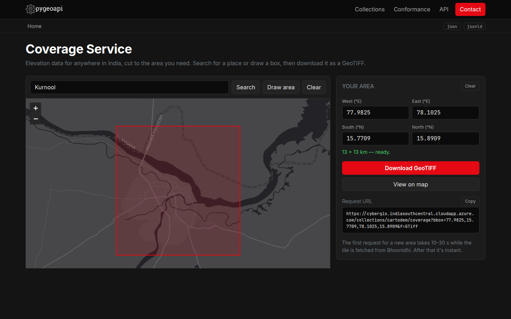

# CYBERGIS

This repo has the implementation of **OGC API - Coverages** using [pygeoapi](https://pygeoapi.io/), serving
ISRO/NRSC's **CartoDEM 30 m** elevation data from [Bhoonidhi](https://bhoonidhi.nrsc.gov.in).

#### Live website: **[cybergis.indiasouthcentral.cloudapp.azure.com](https://cybergis.indiasouthcentral.cloudapp.azure.com)**

[](https://cybergis.indiasouthcentral.cloudapp.azure.com)

Search for a place in India (or draw a box on the map) and download its elevation as a GeoTIFF, or request it
directly from the API:

```bash
curl -o hyderabad.tif \
  "https://cybergis.indiasouthcentral.cloudapp.azure.com/collections/cartodem/coverage?bbox=78.40,17.35,78.50,17.45&f=GTiff"
```

**Full documentation:** [OGC_API_COVERAGES.md](OGC_API_COVERAGES.md) covers the gap evidence, service design, implementation choices, API reference, compliance results, setup and known limitations.

---

## Identified Gap

Bhoonidhi doesn't provide a standard way to get only the part of a raster that a user needs. Users have to download the full product and clip it themselves.

## Proposed Fix

Implement **OGC API - Coverages** using pygeoapi, which does the same job as WCS. It returns only the area or bands the user requests. The first dataset will be **CartoDEM** (single-band), and after that it can be extended to multi-band rasters and time.
